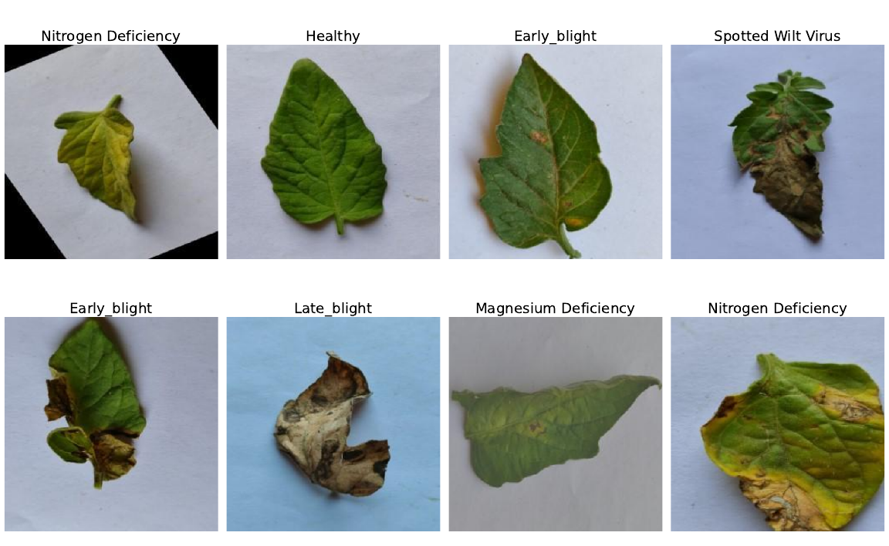
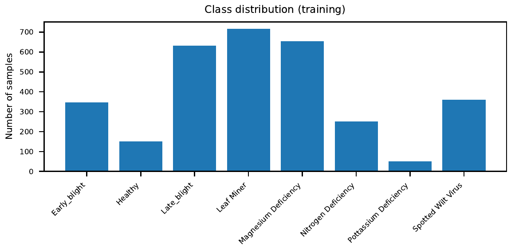
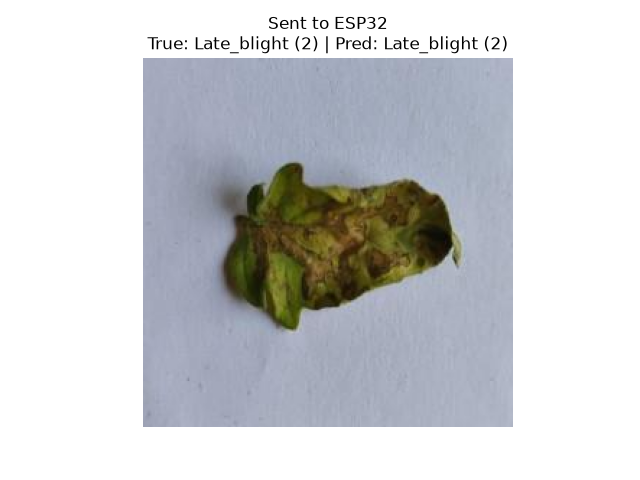
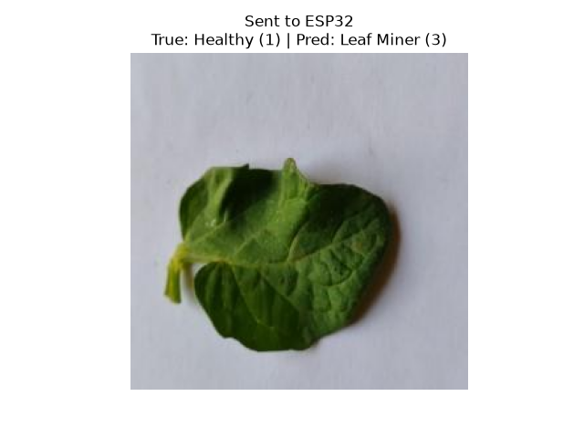

# YuNet for Tomato Leaf Classification on ESP32-S3

This research evaluates an adaptation of YuNet-N for classifying eight tomato leaf conditions in the Tomato-Village dataset. It compares YuNet-N with MobileNetV2 variants trained from scratch or fine-tuned from ImageNet weights.

The experimental workflow trains models in PyTorch, exports quantized INT8 models to TensorFlow Lite, and evaluates inference on the ESP32-S3 with TensorFlow Lite Micro and ESP-NN. A host computer preprocesses the images and sends input tensors to the device over HTTP.

## Dataset

The multiclass Tomato-Village split contains 3,162 training, 902 validation and 461 test images. The [download notebook](data/tomato_village_dataset.ipynb) retrieves the dataset from Kaggle.



*Training samples on the top row and test samples on the bottom row. Labels follow the dataset class names.*



## ESP32-S3 inference

The INT8 YuNet-N baseline correctly classified 402 of 461 test images (87.20%), with a macro-F1 of 85.71% and a mean on-device inference time of 737.12 ms.

| Test sample 100 | Test sample 50 |
| --- | --- |
|  |  |

See the [training experiments](training/README.md), [ESP32-S3 benchmark records](results/esp32s3/) and [desktop export validation reports](results/desktop/).

## Scripts

- [`scripts/evaluate/`](scripts/evaluate/) contains the full test-set benchmark (`evaluate_esp_model.py`), the single-image client (`teste_inferencia.py`) and input tensor metadata for each deployed model. The clients use NumPy, Pillow, Requests and Matplotlib. The benchmark also uses tqdm.
- [`scripts/export/`](scripts/export/) contains the MobileNetV2 deployment reexport scripts. Select the script that matches the architecture and pass the multiclass dataset root, the checkpoint and the output directory. The 1.00 script accepts checkpoints from both training protocols.

Run the benchmark from the repository root with the board running the matching firmware:

```bash
ESP32_IP="<board-ip>" \
DATASET_DIR="/path/to/multiclass/test" \
INPUT_INFO_PATH="scripts/evaluate/input_info/yunet_baseline.json" \
python scripts/evaluate/evaluate_esp_model.py
```

To run inference on one test image, use `teste_inferencia.py` with the same variables and set `IMAGE_INDEX` to the desired test sample index.
